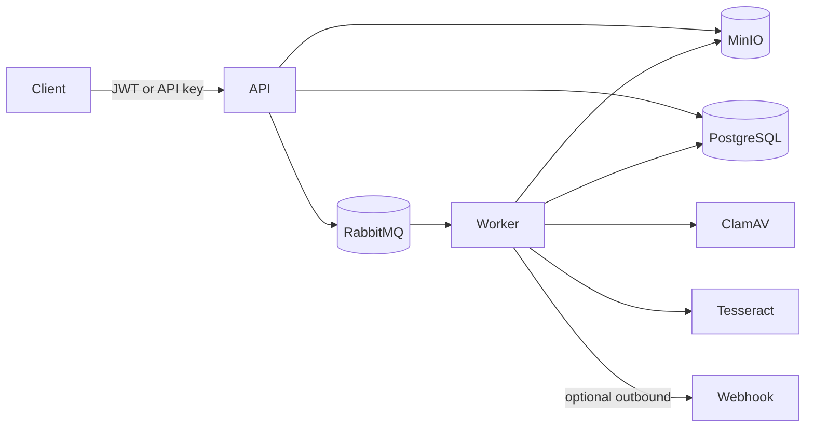

# Architecture

| Quality attribute | Current mechanism | Evidence or limitation |
| --- | --- | --- |
| Scalability | Competing RabbitMQ consumers and object storage | Worker replicas scale independently; load tests are not included. |
| Reliability | Persistent messages, manual acknowledgements, DLQ, idempotent completed state | Database commit and message publish are not atomic yet; see ADR 0002. |
| Security | JWT/API-key boundary, signature checks, ClamAV, signed downloads | Production identity and network controls remain deployment concerns. |
| Observability | Correlation IDs, audit rows, Serilog, OpenTelemetry | No dashboard, alert rules, or SLO validation is included. |
| Resource efficiency | Uploads spool to a temporary file before hashing and storage | Temporary disk must be sized for concurrent upload limits. |

Uploaded content, filenames, MIME types, webhook destinations, queue payloads, and OCR output are untrusted. Production deployments should isolate workers, restrict egress, enforce object retention, and cap temporary storage.
